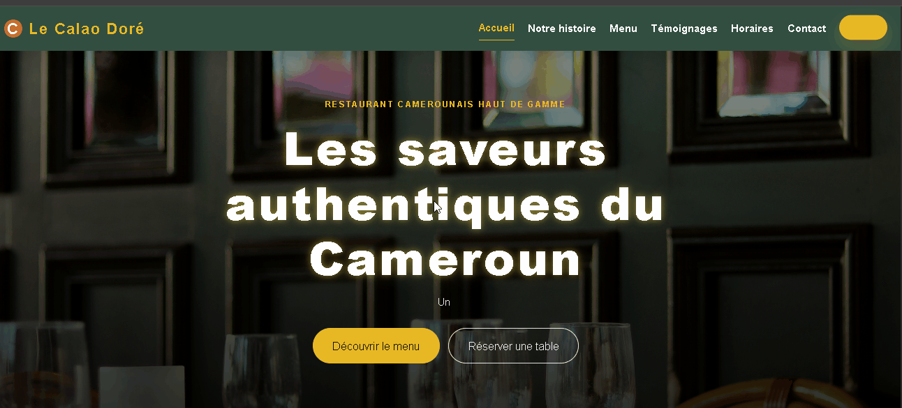
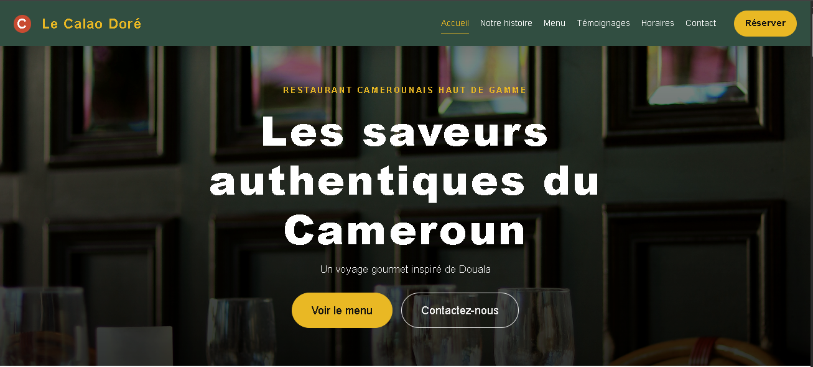
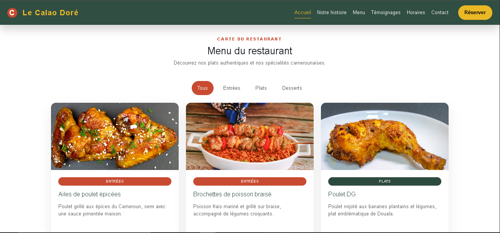
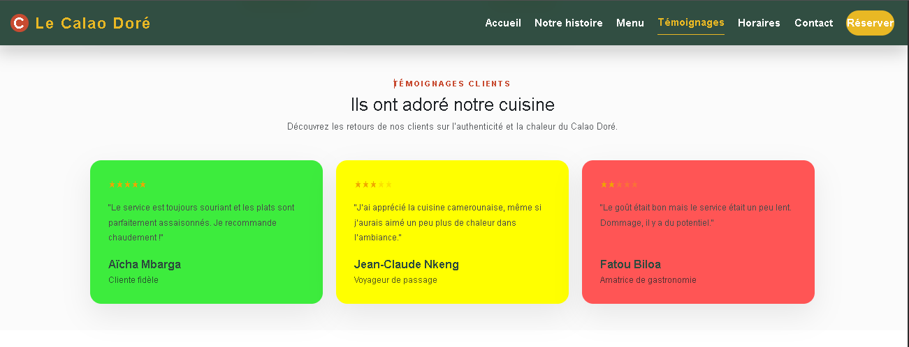
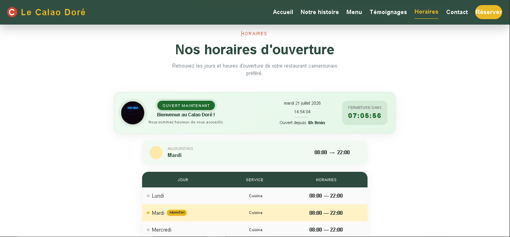

# 🍴 Le Calao Doré — Site Vitrine Premium


---

## 🚀 Live Demo
👉 https://le-calao-dore-five.vercel.app/

---

🎬 Aperçu du projet



---

**Slogan** : *Les saveurs authentiques du Cameroun*

Le Calao Doré est un **site vitrine moderne** pour un restaurant camerounais haut de gamme à Douala. Développé avec **Angular 22** en standalone components, avec SSR et animations fluides.

---

## 📌 Présentation

Ce projet présente un restaurant camerounais authentique à travers :

- 🎨 **Design raffiné** avec palette Forest / Terracotta / Gold
- 📱 **Responsive mobile-first** (400px → 1200px+)
- ⚡ **Animations fluides** (typewriter, glow, breathe, pulse)
- 🍽 **Countdown live** des horaires d'ouverture
- 🧭 **Navigation smooth scroll** avec menu burger
- 🚀 **SSR** (Server-Side Rendering) avec Angular Universal

---

## ✨ Fonctionnalités principales

### 🏠 Hero Section
- Background image avec overlay
- Animation **typewriter** sur le sous-titre
- Effet **glow** animé sur le titre
- Deux CTA (primaire / secondaire)

### 📖 Notre histoire
- Présentation narrative du restaurant
- Image de fond responsive
- Points clés avec icônes Bootstrap
- Card avec bordure subtile

### 🍽 Menu interactif
- **8 plats** répartis en 3 catégories (Entrées, Plats, Desserts)
- Filtres dynamiques par catégorie
- Cartes avec images, badges colorés
- Prix en FCFA

### ⭐ Témoignages clients
- **3 avis clients** avec système d'étoiles (1-5)
- Couleurs dynamiques selon le rating (rouge/jaune/vert)
- Effet hover avec élévation

### 🕐 Horaires en temps réel
- **Statut ouvert/fermé** avec image dynamique
- **Countdown live** qui se met à jour chaque seconde
- Carte "Aujourd'hui" avec horaires du jour
- Tableau complet de la semaine
- SSR-safe avec `Renderer2`

### 📍 Footer
- Coordonnées complètes (adresse, téléphone, email)
- Réseaux sociaux (Facebook, Instagram, WhatsApp)
- Liens rapides vers les sections
- Copyright automatique

---

## 🧠 Points techniques clés

- ✅ **Angular 22** avec Standalone Components
- ✅ **SSR** avec Angular Universal
- ✅ **TypeScript** strict avec interfaces explicites
- ✅ **Renderer2** pour manipulations DOM sécurisées
- ✅ **setInterval** pour countdown live (SSR-safe)
- ✅ **Responsive mobile-first** avec 7 breakpoints
- ✅ **Animations CSS** (breathe, pulse, typewriter, glow)
- ✅ **Bootstrap 5** + Bootstrap Icons
- ✅ **Comments JSDoc** sur toutes les classes et méthodes

---

## 🏗️ Project Architecture

```text
src/
│
├── app/
│   ├── app.ts                      # Composant racine
│   ├── app.html                    # Template racine
│   ├── app.config.ts               # Configuration browser
│   ├── app.config.server.ts        # Configuration SSR
│   ├── app.routes.ts               # Routes
│   └── components/
│       ├── header/                  # Navigation sticky
│       │   ├── header.ts
│       │   ├── header.html
│       │   └── header.css
│       ├── hero/                    # Section héro
│       │   ├── hero.ts
│       │   ├── hero.html
│       │   └── hero.css
│       ├── about/                   # Notre histoire
│       │   ├── about.ts
│       │   ├── about.html
│       │   └── about.css
│       ├── menu/                    # Carte des plats
│       │   ├── menu.ts
│       │   ├── menu.html
│       │   └── menu.css
│       ├── temoignages/            # Avis clients
│       │   ├── temoignages.ts
│       │   ├── temoignages.html
│       │   └── temoignages.css
│       ├── horaires/               # Horaires + countdown
│       │   ├── horaires.ts
│       │   ├── horaires.html
│       │   └── horaires.css
│       └── footer/                  # Pied de page
│           ├── footer.ts
│           ├── footer.html
│           └── footer.css
├── assets/
│   ├── images/                      # Images statiques
│   └── menu/                        # Images des plats
├── styles.css                       # Variables globales
└── index.html                       # Point d'entrée

docs/
├── implementation.md                # Guide technique
├── quick_start.md                   # Démarrage rapide
├── guide.md                         # Guide complet
├── commits.md                       # Stratégie de commits
└── checklist.md                     # Checklist projet
```

---

## 📸 Screenshots

### 🏠 Hero Section


### 🍽 Menu


### 🍽 Témoignages


### 🍽 Horaire


---

## ⚙️ Installation

```bash
# 1. Cloner le dépôt
git clone https://github.com/Hunter13-cmr/le-calao-dore.git
cd le-calao-dore

# 2. Installer les dépendances
yarn install
# ou npm install

# 3. Lancer le serveur de développement
yarn start
# ou npm start
```

👉 **Accès** : http://localhost:8080

---

## 📦 Production Build

```bash
# Build avec SSR
yarn build

# Preview du build SSR
yarn serve:ssr:le-calao-dore
```

**Output** : `dist/le-calao-dore/browser/`

---

## 🎨 Design System

### Palette de couleurs
- **Forest** (`#2D4A3E`) — Couleur principale
- **Terracotta** (`#C84B31`) — Accent chaud
- **Gold** (`#E9B824`) — Couleur premium
- **Cream** (`#FAF3E0`) — Fond neutre

### Typographie
- **Police** : Poppins (Google Fonts)
- **Hiérarchie** :
  - H1 : `clamp(2.75rem, 5vw, 5.5rem)`
  - H2 : `clamp(2rem, 3vw, 2.75rem)`
  - Body : `1rem`

### Animations
- **Breathe** : Scale 1 → 1.08 (icône horaires)
- **Pulse** : Box-shadow glow (badge horaires)
- **Typewriter** : Effet machine à écrire (hero subtitle)
- **Glow-text** : Text-shadow animé (hero title)

---

## 🧪 Tests et validation

### Manuel
- [ ] Hero s'affiche avec animations
- [ ] Navigation smooth scroll fonctionne
- [ ] Menu burger s'ouvre/ferme sur mobile
- [ ] 8 plats affichés dans Menu
- [ ] Filtres catégories fonctionnent
- [ ] 3 témoignages avec étoiles
- [ ] Horaires : statut dynamique + countdown
- [ ] Footer : coordonnées + réseaux
- [ ] Aucune erreur console (F12)

### Build
```bash
yarn build
```
- ✅ Compilation réussie
- ⚠️ Budget warnings acceptables (< 1MB)

---

## 📚 Documentation

| Fichier | Description |
|---------|-------------|
| `README.md` | Ce fichier — vue d'ensemble |
| `docs/implementation.md` | Architecture et modules |
| `docs/quick_start.md` | Démarrage en 3 étapes |
| `docs/guide.md` | Guide complet (SSR, responsive, images) |
| `docs/commits.md` | Stratégie de commits Git |
| `docs/checklist.md` | Checklist complète du projet |

---

## 🗺️ Roadmap

### ✅ MVP (actuel)
- [x] Header + Hero
- [x] About + Menu
- [x] Témoignages
- [x] Horaires avec countdown
- [x] Footer
- [x] Responsive
- [x] SSR
- [x] Documentation complète

### 🚀 V2 (optionnel)
- [ ] Page de contact séparée
- [ ] API de réservation
- [ ] Galerie photos
- [ ] Internationalisation (fr/en)
- [ ] Tests unitaires (Vitest)
- [ ] Tests E2E (Playwright)
- [ ] PWA
- [ ] Analytics

---

## 👨‍💻 Auteur

Développé par **ELOCK SADRACK FIDELE**

**Projet Angular – Formation Développement Web Front-end Angular Talent Lab 2026 (Orange Digital Center)**

---

## 📜 Licence

**Projet académique – libre d'utilisation à des fins éducatives.**

---

<p align="center">
  Fait avec ❤️ à Douala
</p>